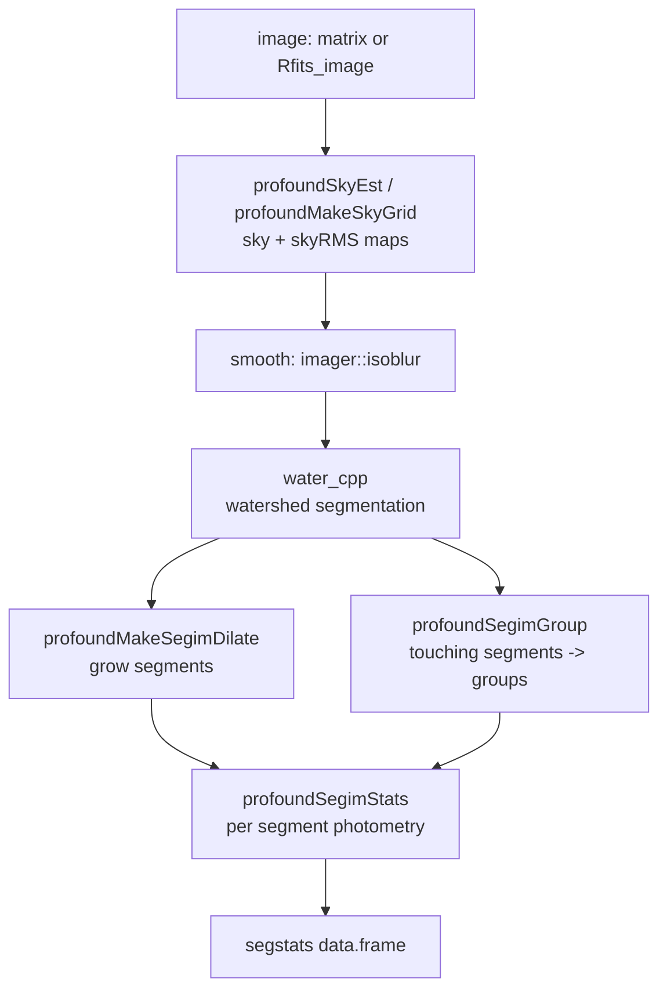

# AGENTS.md

Guidance for AI coding assistants working in the **ProFound** R package
(`/Users/aaron/Rprojects/ProFound`).

## What this package is

ProFound is an astronomical source extraction and photometry package. Its job is
to take an image (or a set of images in several bands) and produce a catalogue of
detected objects with fluxes, sizes, shapes and error estimates. Everything hangs
off `profoundProFound()`, which runs the whole pipeline: sky estimation →
watershed segmentation → segment clean-up → `segstats` catalogue.

The pipeline is roughly:



Key vocabulary:

| term | meaning |
|------|---------|
| **segim** | integer matrix, 0 = sky, 1..N = object IDs. The *dilated* (total) map. |
| **segim_orig** | the pre-dilation map; used for isophotal / colour photometry |
| **objects** | 0/1 integer matrix, `as.logical(segim)` |
| **segstats** | one row per segment: `flux`, `mag`, `R50`, `axrat`, `ang`, errors, ... |
| **group / groupim** | connected groups of *touching* segments, for deblending |
| **sky / skyRMS** | full-size matrices, not scalars, in `profoundProFound` output |

## Pixel conventions (get this right or flux is wrong)

* Image index `[i, j]` has **ProFound coordinate** `(i - 0.5, j - 0.5)`. The
  centre of the first pixel is `(0.5, 0.5)`, not `(1, 1)`.
* `profoundSegimStats` reports `xcen`/`ycen` in this convention.
* Magzero: `mag = -2.5 log10(flux) + magzero`. `profoundFlux2Mag` returns `NA`
  for flux `<= 0` and for `NA`; it returns `0` when `flux == 0` is coerced.

## Layout

```
R/                    one file per topic; most functions are plain `=` definitions
  profoundProFound.R  the main pipeline + plot.profound
  profoundSegim.R     segmentation, dilation, stats, grouping, comparison
  profoundSky.R       sky estimators (flat, local, grid, scan, polynomial, FFT)
  profoundAperPhot.R  aperture photometry (.fluxcalcapp is the workhorse)
  profoundMultiBand.R multi band wrapper (needs ProPane)
  profoundFitMagPSF.R PSF fitting photometry for unresolved sources
  profoundSegimFix.R  interactive / scripted segim editing (Keep, Merge, Zap)
  profoundUtility.R   unit conversions, MakeSigma, GainEst, Resample, CatMerge
  this_in_that.R      fast set membership (%fin%, %nin%)
src/                  Rcpp: water.cpp (watershed), *_cover.cpp, *_flux.cpp, ...
inst/extdata/         test FITS images (VIKING/, MultiBand/, IRdata/)
vignettes/            .Rmd examples; they are the best usage documentation
tests/testthat/       see "Testing" below
data/FPtest.rda       example catalogue, documented via man/FPtest.Rd
```

Functions are exported by `exportPattern("^[[:alpha:]]+")` in `NAMESPACE`, so
anything not starting with `.` is public. Internals start with a dot
(`.meanwt`, `.fluxcalc`, `.makeBrush`, ...).

`NAMESPACE` and `man/*.Rd` are **hand maintained** — do not run
`devtools::document()`; it will rewrite `DESCRIPTION`/`NAMESPACE` and add stray
Rd files for roxygen comments in `R/RcppExports.R`.

## Testing

```r
devtools::load_all(); testthat::test_dir("tests/testthat")
# or, the way CI runs it:
devtools::test()
```

* Suite is ~580 expectations across 14 files and runs in about 30 seconds.
  Keep it fast: prefer small synthetic images (<= 200x200) over the bundled
  FITS files, and never ship a test that takes seconds.
* `tests/testthat/helper-images.R` holds the shared fixtures. Use and extend
  these rather than growing ad-hoc images inside test files:
  * `makeTestImage()` — flat sky + Gaussian noise + Gaussian sources, with
    positions in ProFound coordinates.
  * `addTestSources()` — stamp PSF-shaped point sources with known fluxes.
  * `makeTestSegim()` — a 21x21 map with a touching pair (1, 2) and two
    isolated segments (3, 4).
  * `makeTestPSF()`, `makeTwoHills()`, `makeGroupedProFound()`,
    `runProFound()` (quiet `profoundProFound`).
  * `test-flux-deblend.R` keeps its own `makeDeblendCase()` (a blended pair
    plus an isolated source) and `makeDeblendTriple()` (a three segment group),
    because the deblend needs blends with a specific flux ordering. Both feed
    `runDeblend()`, which is the single call the assertions vary.
* Attach a meaning to `expect_equal()`: assert a recovered flux against the
  flux that was put in, an area against `pi * r^2`, a perimeter against the
  known boundary, `mag` against `profoundFlux2Mag(flux)`. Prefer `expect_equal`
  with a tolerance over `expect_true(x > 0)`.
* `profoundProFound`, `profoundMakeSegim` and friends emit `message()`s (box /
  grid clipping on small images, chosen sky type). Either call `runProFound()`
  or wrap in `suppressMessages()`, or the suite becomes noisy.
* Any test using graphics must open a null device, e.g.
  `grDevices::pdf(file = NULL); on.exit(grDevices::dev.off())`.
* Use `skip_if_not_installed()` for Suggests (`ProPane`, `ProFit`, `imager`,
  `EBImage`, `Highlander`, `Rwcs`). Don't gate on options or environment
  variables.

### Behaviour worth knowing before writing assertions

* `tabulate()` on an integer **matrix** treats it as a vector and drops the
  zeros, so `tabulate(segim)` is already the per-segment pixel count (32 and 32
  for `makeTwoHills()`). Slicing `[-1]` to drop the sky count is a common
  mistake; it only makes sense for the raw `table()` output.
* `profoundSegimEdge()` keeps the *bordering* pixels and zeros the interior, so
  a 4x4 block becomes 12 edge pixels plus a 2x2 hole (not a 2x2 remnant). It is
  the `boxblur` based implementation, so pixels are only stripped once their 3x3
  neighbourhood is entirely the same segment.
* `profoundSegimKeep(groupim=, groupID_merge=)` only relabels; `clean = TRUE`
  removes the original IDs. Merging a *single-segment* group is a no-op.
* `profoundSegimMerge()` renumbers the *add* map to `max(base) + 1` and keeps
  whichever of the pair contains the image peak; matching peaks mean the add
  segment is dropped.
* `profoundSegimStats` only computes `Nborder`/`flag_border`/`edge_frac` with
  `boundstats = TRUE`, `asymm`/`flux_reflect` with `rotstats = TRUE`; otherwise
  those columns are `NA`. `edge_frac` is the fraction of the segment border
  facing *sky*, not the image edge.
* `profoundSegimStats` for a zero flux segment leaves `mag` as `NA` and sets
  `N50`/`N90` to `N100`.
* `profoundFluxDeblend` conserves the group footprint flux exactly
  (`sum(flux_db)` = the sky-subtracted footprint sum), and `flux_segfrac` is the
  plain isophotal share, so both are model independent and cheap to assert.
  `flux_db` itself is *not*: `deblendtype` (`fit`/`gauss`/`psf`) decides the
  split, and `fit`/`gauss` are biased for the wrong source profile. Only
  `psf` with a genuinely PSF-shaped pair recovers the input ratio (~10%).
  `N100_db` sums to the footprint pixel count, and `Qgroup_db` is one number
  broadcast to all members of a group.
* `profoundFluxDeblend` honours an explicit `sky =` over any sky taken from a
  passed `profound` object, for both `image = x` and `profound = x`. The
  `profound = x` branch used to ignore `x$sky` entirely (fixed), so scripts that
  worked around it by pre-subtracting the sky *and* passing `profound =` now
  subtract twice: the pipe is ~100 counts against a ~6400 count group footprint,
  so `flux_db` and `N100_db` collapse to exactly 0 for every grouped segment,
  silently. Pass `sky = 0` to keep such a workflow working; there is a
  regression test for this in `test-flux-deblend.R`.
* `profoundFluxDeblend(magzero = )` rebuilds only the *grouped* rows via
  `profoundFlux2Mag`, while ungrouped rows reuse `segstats$mag`. Pass the same
  `magzero` that `profoundProFound` used, or the magnitudes disagree.
* `profoundFluxDeblend` returns `NULL` (not an empty frame) when no group has
  more than one member, or when `Ndeblendlim` excludes them all.
* `profoundMakeSegim` with no detections returns a **zero-row** data.frame, not
  `NULL`; with `stats = FALSE` or an all-sky `segim` it returns `NULL`.
* `profoundSkyEst` on a *perfectly constant* image yields `sky = NaN`
  (`skyRMS = 0`) and poisons the downstream estimate. Pass `sky`/`skyRMS`
  explicitly when testing flat images, or use noisy data.
* `profoundMultiBand(dir = ...)` pastes the band name straight onto `dir`, so
  `dir` must end with a path separator.
* Multi band columns carry a per-block suffix: `t` (total), `c` (isocolour),
  `g` (group) — e.g. `mag_Zt`, `mag_Zc`, `mag_Zg`.
* The bundled `MultiBand/*.fits` images have **no usable WCS**; anything that
  stacks them (`profoundMultiBand` with `detectbands`) fails. Use
  `VIKING/mystery_VIKING_Z.fits` (356x356, real WCS) instead.
* `profoundMakeSegim` / `profoundProFound` require a bare matrix;
  `profoundSegimStats` etc. happily take `Rfits_image`. `profoundProFound` and
  `profoundAperPhot` accept `Rfits_image`, `Rfits_pointer` or `matrix` and pull
  `keyvalues` off the FITS object automatically.
* `profoundFitMagPSF` sorts results brightest first and reports `psfstats`;
  input coordinates are ProFound coordinates (index - 0.5). Flux recovery is
  only accurate to ~20% at modest SNR, so assert with a tolerance.
* Results are seed-dependent: always `set.seed()` and pick a random integer.
* Masking a source region needs the *data* masked too, or the sky estimator's
  neighbourhood sees the source and the test is meaningless.

## Style in this codebase

Match the surrounding code, which is **not** the tidyverse:

* `=` for assignment, not `<-`; single quotes for strings in `R/`; no roxygen
  for plain R files.
* `snake_case` inside functions is used for some newer code
  (`profoundSkyScan`, `profoundPixelCorrelation`), `camelCase` elsewhere. Follow
  the file you are editing.
* Heavy use of `data.table` (`tempDT[, .fluxcalc(flux), by = segID]`) inside
  `profoundSegimStats` and friends; avoid `dplyr`.
* `.cpp` hot loops live in `src/` and are exposed via `R/RcppExports.R`. If you
  touch a `// [[Rcpp::export]]` function you must re-run
  `Rcpp::compileAttributes()` and rebuild — but nothing else regenerates
  `NAMESPACE`.

## Before claiming a change works

1. `devtools::load_all(); testthat::test_dir("tests/testthat")` — no failures,
   no new warnings, no leaked messages.
2. For anything touching segmentation or photometry, sanity-check against a
   synthetic image with a *known* answer (see `makeTestImage`), not just "it
   returned a data.frame".
3. `R CMD build --no-build-vignettes` then
   `R CMD check --no-manual --no-vignettes --no-build-vignettes <tarball>`.
   There are pre-existing warnings (vignettes not built, a `profoundMultiBand`
   codoc mismatch); `checking tests ... OK` is what matters. Delete the tarball
   and `.Rcheck` directory afterwards.